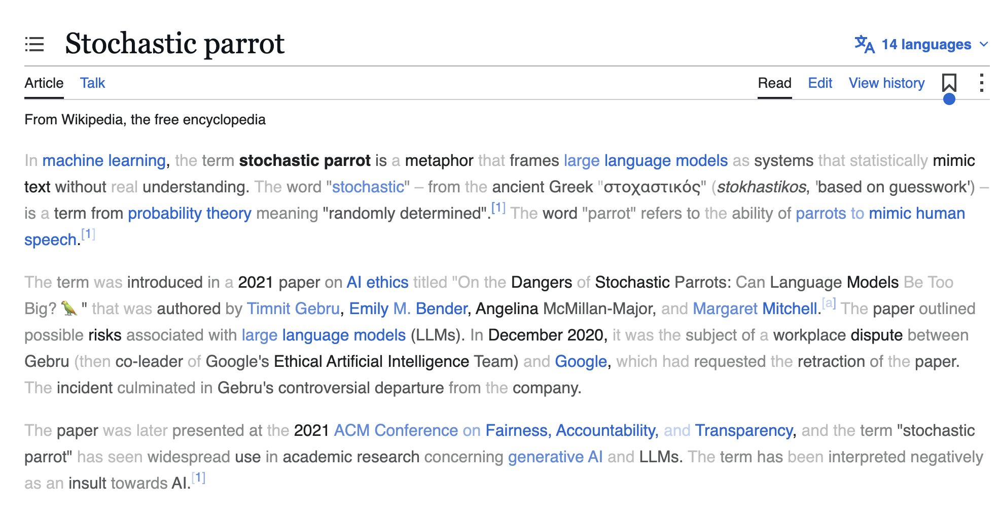

# Skimmer

Skimmer is a Firefox and Brave (Chromium) extension for easier reading of long texts. It modulates text opacity to highlight only semantically important words in HTML web pages and PDF files. It uses a small local BERT-style model, so no AI summarization. The content is there, it just becomes easier to skim, as shown:

## Usage
- Click the icon to toggle highlights.
- Right-click the icon and tick "Lightweight scoring (no model)" to fade common English words instead. It is faster but worse.
- On a PDF, the icon reopens it in Skimmer's own viewer (click again to go back). Some sites ask you to allow access once. Local PDF files are not supported.

## Installation

### Firefox
1. Navigate to about:debugging#/runtime/this-firefox.
2. Click "Load Temporary Add-on…" and select manifest.json in the Skimmer folder.

Temporary add-ons are removed when Firefox restarts.

### Brave
1. Navigate to brave://extensions and turn on "Developer mode".
2. Click "Load unpacked" and select the Skimmer folder.

In both browsers, you may **pin the icon from the Extensions (puzzle) menu**.

## Credits and disclaimers
I vibe-coded this extension based on the paper: *Gu, Ziwei, Ian Arawjo, Kenneth Li, Jonathan K. Kummerfeld, and Elena L. Glassman. "An AI-resilient text rendering technique for reading and skimming documents." In Proceedings of the 2024 CHI Conference on Human Factors in Computing Systems, pp. 1-22. 2024.* Here is their [code](https://github.com/ZiweiGu/GP-TSM?tab=readme-ov-file). They used GPT so their results are better in terms of readability, but requires heavy compute.

The model (14 MB) is downloaded on first use from [atjsh/llmlingua-2-js-tinybert-meetingbank-onnx-v4](https://huggingface.co/atjsh/llmlingua-2-js-tinybert-meetingbank-onnx-v4). This is a third-party Hugging Face repo, and it has no license. The download is pinned to one commit and checked against the SHA-256 published in that repo, so it is only as trustworthy as the repo itself. Use lightweight scoring if you don't trust it.

The English word list (`source/words.txt`) is from [wordfreq](https://github.com/rspeer/wordfreq) by Robyn Speer, licensed [CC BY-SA 4.0](https://creativecommons.org/licenses/by-sa/4.0/).

The icon is the owl from [Fluent Emoji](https://github.com/microsoft/fluentui-emoji) by Microsoft, licensed [MIT](https://github.com/microsoft/fluentui-emoji/blob/main/LICENSE).

The PDF viewer uses [PDF.js](https://github.com/mozilla/pdf.js) by Mozilla, licensed [Apache 2.0](https://www.apache.org/licenses/LICENSE-2.0).
